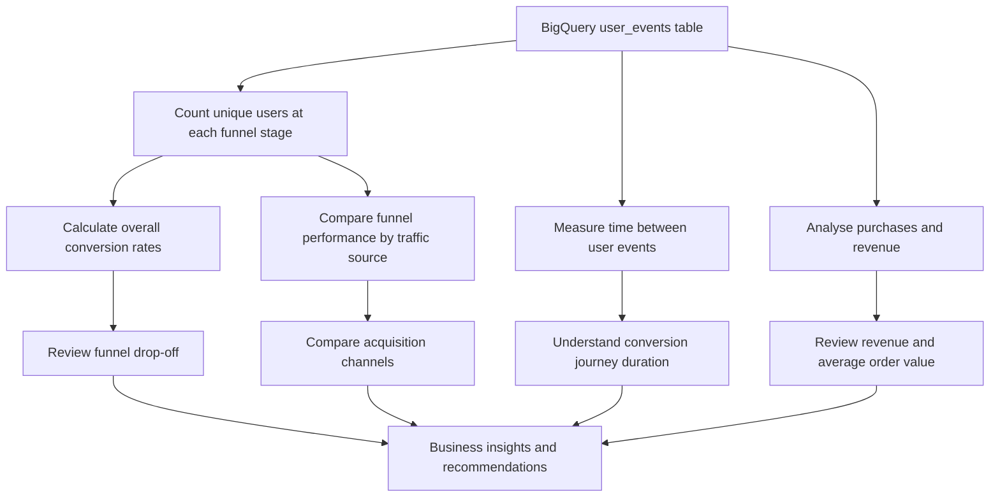

# User Analytics & Sales Funnel Analysis

A Google BigQuery SQL project that analyses user behaviour across five sales-funnel stages: page view, add to cart, checkout start, payment information, and purchase. The queries measure funnel size, stage-to-stage conversion, acquisition-channel performance, time to conversion, and purchase revenue.

## High-level architecture



## Business questions

- How many unique users reach each of the five funnel stages?
- What proportion of users progress between stages and from initial view to purchase?
- How does funnel performance differ by traffic source?
- How long does it take converting users to move from viewing a page to adding to cart and purchasing?
- How many purchase events and purchasing users are recorded, and what are total revenue and average order value?

## Repository structure

```text
Sales-Funnel-Analysis/
├── README.md
├── .gitignore
├── sql/
│   ├── 01_overall_sales_funnel.sql
│   ├── 02_sales_funnel_conversion_rates.sql
│   ├── 03_sales_funnel_by_traffic_source.sql
│   ├── 04_conversion_rate_by_traffic_source.sql
│   ├── 05_time_to_conversion.sql
│   └── 06_revenue_analysis.sql
└── Docs/
    ├── project_overview.md
    ├── data_dictionary.md
    ├── methodology.md
    └── findings_and_limitations.md
```

## Tools

Google BigQuery and SQL.

## Setup and run

1. Make sure you have access to a BigQuery dataset containing an `user_events` table with the fields documented in `Docs/data_dictionary.md`.
2. In each SQL file, replace `YOUR_PROJECT_ID.YOUR_DATASET.user_events` with your actual fully qualified BigQuery table name.
3. Open the query file in BigQuery SQL workspace and run it. Review the output before drawing conclusions.

## Query modules

| File | Purpose |
|---|---|
| `01_overall_sales_funnel.sql` | Counts distinct users at each stage. |
| `02_sales_funnel_conversion_rates.sql` | Calculates stage-to-stage and overall conversion percentages. |
| `03_sales_funnel_by_traffic_source.sql` | Counts funnel-stage users for each traffic source. |
| `04_conversion_rate_by_traffic_source.sql` | Calculates funnel conversion percentages by source. |
| `05_time_to_conversion.sql` | Estimates elapsed time between key events for users who purchased. |
| `06_revenue_analysis.sql` | Summarises purchase events, purchasing users, total revenue, and average order value. |

## Findings and limitations

The uploaded SQL contains query definitions, not query-result tables. This repository therefore documents what the queries calculate, but does not claim any conversion rates, revenue totals, or highest-performing traffic source.

The time-to-conversion query uses `TIMESTAMP_DIFF(..., MINUTE)`, so confirm that `event_date` is a compatible timestamp/datetime field in your BigQuery table. The time query uses the earliest observed view, cart, and purchase events per user; it does not by itself prove that each event belongs to the same session or a strictly ordered journey.

The original revenue calculation sums `amount` only for purchase events and divides by the count of purchase events. Confirm the meaning and currency of `amount`, and consider whether each purchase event corresponds to a unique order before interpreting the average as average order value.
